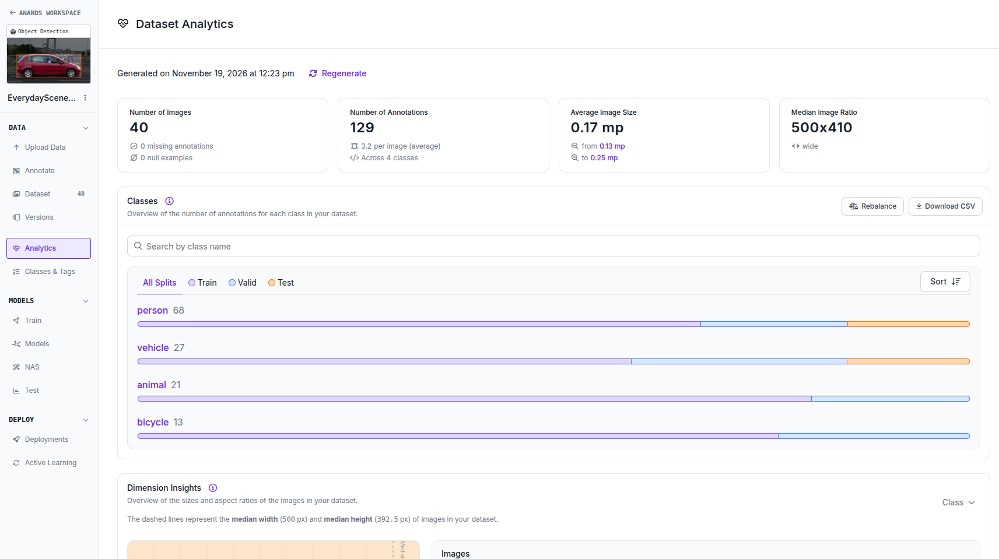
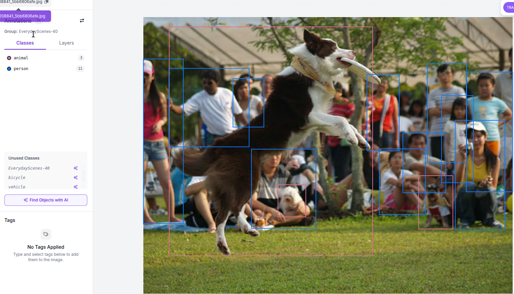

# EverydayScenes-40 — Object Detection Dataset

A manually curated and annotated 40-image object detection dataset built from a filtered subset of Flickr 8k, designed to demonstrate production-grade bounding box precision, edge-case consistency, and multi-format export workflows (COCO & YOLOv8) using Roboflow.

## Dataset Overview

| Metric | Value |
| :--- | :--- |
| *Total Images* | 40 (0 missing annotations, 0 null examples) |
| *Total Bounding Boxes* | 129 |
| *Average Annotations / Image* | 3.2 |
| *Dataset Split* | 70% Train (28) / 20% Valid (8) / 10% Test (4) |
| *Preprocessing* | Auto-Orient applied, Resize (Stretch to 512×512), No Augmentation |
| *Export Formats* | COCO JSON, YOLOv8 |

## Class Distribution

| Class | Annotations | Share (%) |
| :--- | :---: | :---: |
| person | 68 | 52.7% |
| vehicle | 27 | 20.9% |
| animal | 21 | 16.3% |
| bicycle | 13 | 10.1% |
| *Total* | *129* | *100%* |

## Annotation Guidelines & Quality Standards

To maintain high label consistency and minimize noise for downstream computer vision models, the following rules were enforced across all 40 images:

- *Tight Bounding Boxes:* Boxes hug object edges strictly without excess background padding; lowercase class naming (person, animal, vehicle, bicycle) enforced across all labels.
- *Overlapping & Multi-Object Separation:* Occluded and overlapping objects (e.g., cyclist + bicycle, horse + carriage, closely parked vehicles, and group scenes) are labeled with separate, individual boxes rather than merged regions.
- *Partial & Edge-Cropped Objects:* Clearly recognizable objects cropped at frame boundaries (e.g., partial vehicles or riders) are annotated up to the visible edge.
- *Consistent Edge-Case Exclusions:* Heavily blurred background crowds without clear boundaries, extreme interior vehicle close-ups, isolated body parts (e.g., a lone hand), and non-road toy ride-on cars are excluded to prevent false positives.

## Sample Annotation

## Workflow & Tools

1. *Data Sampling:* Filtered and sampled 40 diverse everyday scenes from Flickr 8k using a custom Python script (pick.py).
2. *Manual Annotation & QA:* Annotated all 129 instances in Roboflow with a post-annotation audit to verify 0 missing labels and strict class hygiene.
3. *Versioning & Export:* Generated Version 1 with clean 70/20/10 splits and exported directly in *COCO* and *YOLOv8* formats.

## Repository Structure

text
├── README.md
├── pick.py
├── assets/
│   ├── analytics.png
│   └── sample_annotation.png
└── exports/
    ├── coco/
    └── yolov8/
